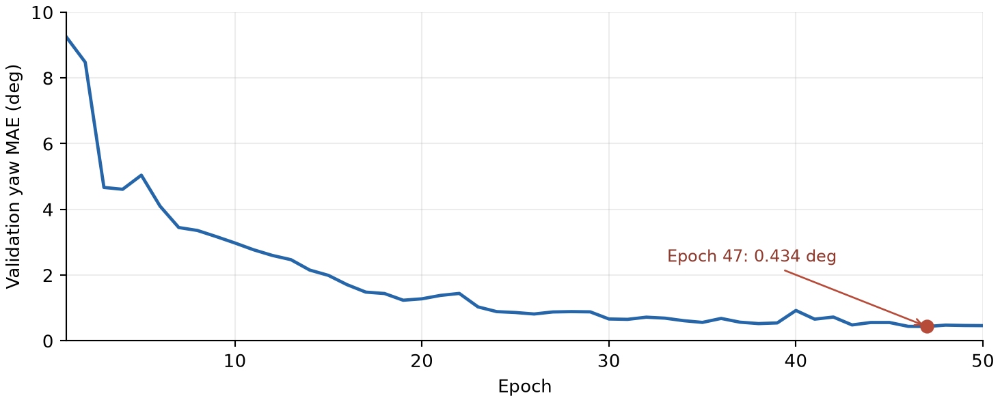
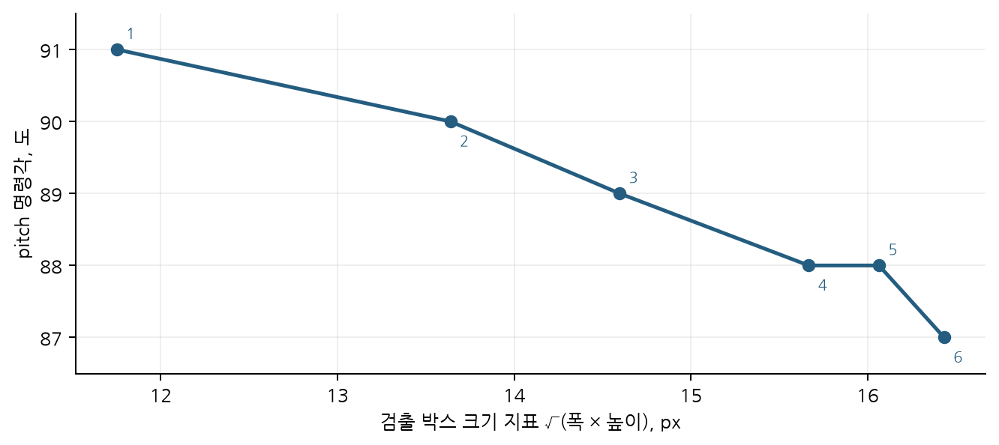
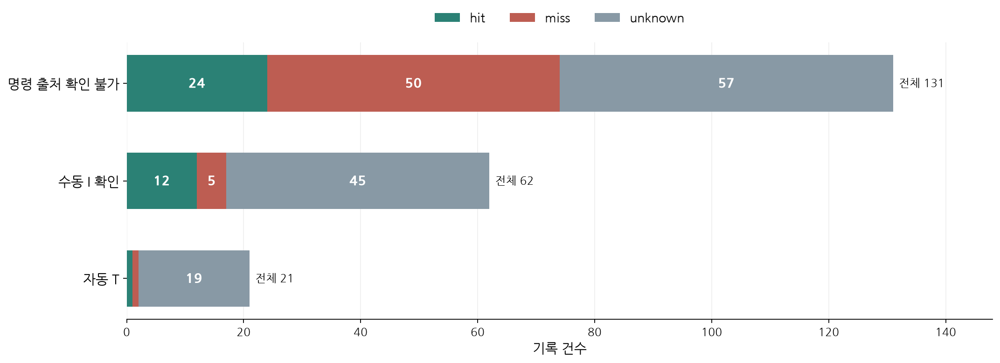
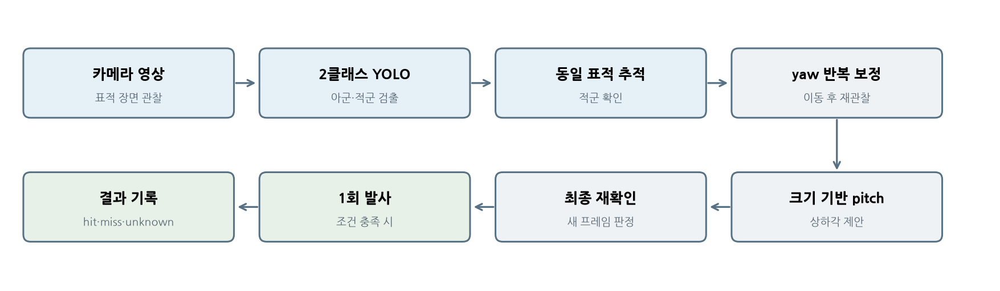

# 인공지능 고무줄총 과제의 표적 인식과 조준 방식 개발

**Physical AI 과제 보고서**

## 초록

본 보고서는 우리 팀이 인공지능 고무줄총의 두 과제를 위해 검토하고 시도한 방법, 방법을 바꾼 이유, 실제 관찰 결과와 최종 실행 구성을 정리한다. 과제는 1.5~2.0 m 사이에서 무작위로 놓인 표적을 맞히는 Task 1과, 같은 거리 범위의 아군·적군 중 적군을 맞히는 Task 2다.

인식 모델 학습에서는 Pi 카메라로 촬영한 사진을 검수하여 아군 242장과 적군 258장, 총 500장을 사용했다. 1296×972 촬영 영상의 중앙 50%를 실행 영상에 맞게 줄여 학습했고, 팀원이 준비한 YOLO 모델을 Pi에 적용했다. 한 장의 영상으로 yaw를 예측하는 방식과 서보 이동 후 새 영상으로 오차를 확인하는 방식을 비교했다. 실기에서는 작은 yaw 명령의 반응 지연과 중심 통과를 관찰하여 동일 표적 추적·반복 관찰 방식으로 바꿨다. 초기에는 같은 조준각에서도 고무줄이 여러 방향으로 날아가 발사각을 조절했고, 이후에는 근소하게 빗나가는 경우를 주로 관찰했다.

최종 자동 경로는 처리 속도를 고려해 선택한 640 center50 아군·적군 YOLO로 **현재 화면에 보이는 enemy**를 선택하고, yaw 정렬, 박스 크기 기반 pitch 결정, 최종 정렬 확인, 단발 발사를 순서대로 수행한다. 화면 밖 표적의 자동 탐색은 현재 경로에 적용되지 않았다. 여러 개발 단계에서 발사 trial을 기록했고 자동 경로의 trial도 있으나, 변경된 두 과제 조건의 최종 성공률은 아직 측정하지 않았다.

**주요어:** 객체 검출, YOLO, 영상 피드백, yaw, pitch, 발사 실험

## 1. Task 구현을 위해 논의한 방법들

### 1.1 과제가 요구하는 판단

수정된 과제는 두 가지다. Task 1에서는 고무줄총에서 1.5~2.0 m 떨어진 임의의 위치에 놓인 표적 한 개를 맞혀야 한다. Task 2에서는 아군과 적군이 각각 같은 거리 범위에서 임의로 배치되며, 적군을 맞혀야 한다. 두 과제 모두 직선 또는 포물선 궤적을 허용하지만, 바닥에 한 번 튄 뒤 맞는 원바운드 탄착은 인정되지 않는다. 따라서 모델이 표적을 검출하는 것만으로 과제 성공을 판단할 수 없다.

**표 1. 변경된 과제의 평가 기준과 현재 확인 범위**

| 과제 | 평가 기준 | 현재 구현과 확인 범위 |
| --- | --- | --- |
| Task 1 | 무작위 거리의 단일 표적을 원바운드 없이 직접 명중 | 단일 표적 검출은 확인했으나 자동 발사 경로에 연결하지 못함. 과제 조건의 직접 명중 미검증 |
| Task 2 | 무작위 거리의 아군·적군 중 적군을 선택해 원바운드 없이 직접 명중 | 적군 선택부터 단발 발사까지 연결. 화면 밖 적군 포착은 비활성이고 어두운 배경 아군 오검출을 관찰함; 과제 조건의 직접 명중 미검증 |

영상에서 박스를 찾는 일, 적군을 선택하는 일, 화면 중심으로 총을 돌리는 일, 고무줄이 실제 표적에 맞는 일은 서로 다른 단계다. 이 구분을 기준으로 인식, 좌우 조준, 상하 조준, 발사 동작에 관한 방법을 검토했다.

이하에서 **yaw**는 총의 좌우 회전각, **pitch**는 상하 회전각을 뜻한다. **박스**는 영상에서 검출한 표적을 둘러싼 사각형이며, **trial**은 발사 한 번과 그 결과를 묶은 기록이다.

### 1.2 검토한 접근

**인식**에는 한 종류의 표적만 찾는 YOLO와 아군·적군을 나누어 찾는 YOLO를 고려했다. 앞의 방법은 영상에서 표적 좌표를 얻는 최소한의 출발점이고, 뒤의 방법은 Task 2의 대상 선택에 직접 대응한다.

**인식 모델 학습**에서는 수업 제공 검출기를 그대로 쓰는 방법과 직접 촬영한 표적 사진을 라벨링해 전용 검출기를 학습하는 방법을 검토했다. 촬영 해상도는 1920×1080, 1296×972, 2592×1944를 비교했고, 학습·실행 화면은 중앙 50%와 전체 영역, 640과 1296 해상도의 조합을 살폈다. 실제 운용 거리에서 표적이 작게 찍히므로 라벨 위치를 확인할 수 있는 촬영 크기와 Pi의 처리 부담을 함께 고려했다.

**최초 표적 포착**에는 화면에 적군이 없으면 yaw 범위를 이동하며 찾는 방법도 논의했다. 다만 최종 정렬 방식에서는 검출 누락 때 자세를 유지하도록 선택했으며, 현재 설정에서 화면 밖 표적을 자동으로 훑어 찾는 절차는 실행되지 않는다.

**좌우 조준**에는 표적 위치를 마스크 영상으로 만들고 CNN이 yaw 보정각을 한 번에 예측하는 접근과, YOLO 박스의 중심 오차를 측정한 뒤 이동 결과를 새 영상에서 다시 확인하는 접근이 있었다. 후자는 이동 명령과 실제 화면 변화가 달라질 수 있다는 점을 다룬다.

**상하 조준**에는 사람이 pitch를 수동으로 바꾸어 시험하는 방식과, 명중 사례에서 얻은 표적 박스 크기와 pitch의 관계를 보간하는 방식이 있었다. 후자는 별도의 거리 측정 없이 화면상 크기를 거리의 간접 단서로 사용하는 시도다.

**발사와 결과 확인**에는 조준 명령과 실제 고무줄 비행을 분리해 살펴야 한다는 문제가 있었다. 실험 중 발사 각도를 조절했고, 이후 영상 정렬, pitch 결정, 최종 확인, 단발 발사를 한 절차로 묶었다.

\Needspace{10\baselineskip}

**표 2. 검토한 방법의 역할**

| 단계 | 방법 | 얻으려는 정보 또는 효과 |
| --- | --- | --- |
| 인식 | 단일 표적 YOLO | 표적 박스의 중심과 크기 |
| 인식·선택 | 아군·적군 YOLO | 적군 선택과 아군 구분 |
| 인식 학습 | 직접 촬영·라벨 검수·해상도와 영역 비교 | 작은 표적을 포함한 학습 자료와 실행 입력 구성 |
| 최초 포착 | yaw 범위 탐색 검토 | 화면 밖 적군을 찾는 방법의 후보 |
| 좌우 조준 | 마스크 기반 yaw CNN | 한 장에서 보정각 예측 |
| 좌우 조준 | 영상 피드백·동일 표적 추적 | 이동 후 남은 오차 확인 |
| 상하 조준 | 수동 pitch 시험·크기 기반 보간 | 거리 변화에 따른 상하각 제안 |
| 발사 | 발사 동작 조절·통합 절차 | 조준 결과를 실제 발사로 연결 |

이 표는 팀원이 준비한 인식 모델과 우리 팀이 Pi에서 검토·구현·시험한 조준·발사 방법의 역할을 정리한다.

### 1.3 무엇을 결과로 볼 것인가

이번 과제에서 가장 중요한 구분은 **화면에서 정렬된 상태**와 **고무줄이 실제로 맞은 상태**의 차이다. 카메라 박스의 중심 오차가 0에 가까워도 카메라와 발사부의 위치, 상하각, 고무줄의 비행 상태에 따라 탄착은 달라진다. 또한 서보 발사 명령이 완료됐다는 로그는 발사 절차의 완료를 뜻할 뿐, 명중 판정이 아니다.

**표 3. 이 보고서에서 사용하는 증거의 단계**

| 증거 | 직접 확인하는 내용 | 이것만으로 확인할 수 없는 내용 |
| --- | --- | --- |
| 카메라 검출 화면·고정 장면 진단 | 표적 박스와 클래스가 나타나는가 | 무작위 배치에서의 탐지율, 명중 |
| yaw CNN 검증 기록 | 수집 영상의 정답각과 예측각 차이 | 서보 이동 후 오차, 탄착 |
| Pi 정렬 콘솔 로그 | 목표를 추적하고 화면 오차를 줄였는가 | 고무줄의 최종 궤적과 직접 명중 |
| trial CSV의 hit·miss·unknown | 실험 당시 입력한 발사 결과 | 발사별 거리·원바운드 여부·unknown 원인 |
| 과제 조건을 적용한 별도 평가 | 두 Task의 직접 명중 여부 | 현재 자료에는 이 수준의 집계가 없음 |

따라서 아래의 실험 결과에서는 증거가 도달한 단계까지만 결론을 낸다. 기록에 없는 거리나 궤적을 역으로 추정해 성공률을 만들지 않는다.

## 2. 논의한 방법 중 시도했던 방법들

실제 시도는 모델을 카메라에서 실행하는 데서 끝나지 않았다. Pi에서 드러난 검출·정렬·발사 문제에 맞춰 절차를 바꾸고 마지막에 한 번의 자동 실행으로 연결했다.

### 2.1 표적 검출에서 대상 구분으로

팀원이 준비한 단일 target 클래스 YOLO를 카메라 영상에 적용해 표적 박스를 얻었다. 이후 팀원이 직접 촬영·검수한 사진으로 friend와 enemy를 구분하는 모델을 학습했고, 우리 팀은 이를 Pi에 적용했다. **640 center50**은 가로 640픽셀 카메라 영상을 회전한 뒤 중앙 절반을 사용하는 실행 구성의 이름이다. Raspberry Pi의 영상 처리 속도를 고려해 이 구성을 최종 기본 인식 모델로 선택했다.

이 변화의 핵심은 모델의 점수만 높이는 일이 아니라 조준 가능한 대상을 제한하는 일이었다. 단일 표적 모델은 Task 2의 아군 배제를 표현할 수 없지만, 두 클래스 모델은 적군 박스만 후보로 넘길 수 있다.

### 2.2 아군·적군 YOLO 학습 자료의 구성

첫 수집에서는 1920×1080 사진 132장을 촬영하고 회전한 영상의 위 25%와 아래 20%를 잘라 사용했다. 수업 제공 검출기가 작은 표적을 찾은 사진은 42장이었다. 그 42장으로 표적 전용 검출기를 학습해 다시 적용하자 총 117장의 라벨을 확보했다. 나머지 15장은 표적이 화면 밖에 있었다. **117/132는 라벨 확보 결과이지 독립 사진에서 검출한 정확도가 아니다.**

초기 모델을 Pi에 적용했을 때 아군과 적군 구분이 불안정해 자료를 다시 촬영했다. 배경색이 다른 여섯 장소에서 1296×972 사진을 아군 308장, 적군 258장 찍었다. 2592×1944 촬영도 검토했으나 처리 속도를 고려해 사용하지 않았다. Claude로 박스 초안을 만든 뒤 사진마다 직접 확인하고, 품질이 낮은 자료는 제외했다. 어두운 배경의 아군 66장은 받침대가 박스에서 빠져 크기를 보정해 보았지만 최종 학습에서는 제외했다. 같은 장소의 적군 64장은 남아 **최종 자료는 아군 242장과 적군 258장, 총 500장**이다.

각 사진의 라벨은 friend(클래스 0) 또는 enemy(클래스 1) 박스 하나다. 파일에는 클래스와 정규화한 중심 좌표·폭·높이 다섯 값을 저장했다. 사진을 90° 회전해 972×1296으로 만든 후, 640 center50 구성에서는 회전 영상 위아래 25%씩을 잘라 중앙 50%를 남기고 480×320으로 줄였다. 이는 Pi에서 640×480 카메라 영상을 같은 방식으로 전처리한 입력에 대응한다. 640·1296 해상도와 중앙 50%·전체 영역의 네 구성을 검토하고 Colab GPU에서 학습·검증 사진을 직접 8:2로 나누어 학습했다.

**표 4. 아군·적군 YOLO 학습 자료의 변화**

| 단계 | 촬영 자료와 처리 | 실제 얻은 결과 | 해석상 주의점 |
| --- | --- | --- | --- |
| 첫 수집 | 1920×1080 사진 132장; 회전 뒤 위 25%·아래 20% 제거 | 제공 검출기로 42장 검출; 전용 검출기로 117장 라벨 확보 | 117장은 학습용 라벨 확보 수, 독립 검출 성능 아님 |
| 재촬영 | 여섯 장소에서 1296×972 사진 아군 308장·적군 258장 | 아군 66장 제외 후 242장·258장, 총 500장 | 제외한 어두운 배경에는 적군 64장만 남음 |
| 최종 640 center50 입력 | 90° 회전, 위아래 25%씩 크롭, 480×320으로 축소 | Pi의 640×480 카메라 전처리와 대응 | 표적이 크롭 영역 밖에 있으면 검출 불가 |

### 2.3 한 장의 각도 예측에서 반복 관찰로

단일 영상으로 yaw 보정량을 구할 수 있는지 확인하기 위해 YOLO가 찾은 박스만 남긴 224×224 흑백 마스크로 CNN을 학습했다. 동시에 Pi에서는 표적 박스 중심과 조준 기준의 가로 차이를 이용하는 방법을 시도했다. 서보를 움직인 뒤에는 이전 박스 좌표를 믿지 않고 새 프레임의 표적 위치를 다시 측정했다.

Pi로 조준을 시험하면서 검출이 잠깐 빠지거나, 작은 명령에 대한 영상 반응이 늦거나, 표적 중심을 지나치는 현상을 관찰했다. 이에 같은 표적을 여러 프레임에서 확인하고, 움직임이 안정된 뒤 새 관측값으로 정렬을 판정하도록 조준 절차를 수정했다. 미세 이동, 중심 통과 후 재확인, 한 프레임 검출 공백 처리 등 Pi 업데이트는 이 목적에 따라 이루어졌다. 보고서에서는 개별 버전 번호나 출력 설정값보다 **관찰한 문제와 변경 의도**를 중심으로 다룬다.

\Needspace{10\baselineskip}

### 2.4 발사 동작과 상하 조준의 수정

초기 발사 시험에서는 기본 수집 프로그램의 방아쇠 발사각이 충분하지 않았다. 우리 팀은 **같은 조준각에서도 고무줄이 여러 방향으로 날아가는 것**을 관찰했다. 이 시기의 unknown에는 발사 궤적이 일정하지 않아 조준 결과를 해석하기 어려웠다는 현장 판단이 반영됐다. 조준 오차와 발사 자체의 불규칙성을 분리할 수 없었으므로 방아쇠 발사각을 조절했다. 그 후에도 표적을 **약간 빗나간 사례**를 당시 기록에서 unknown으로 남겼다. 이는 데이터 수집 당시의 분류이며 과제의 명중 판정과 같지 않다.

상하 조준은 수동 pitch 시험에서 얻은 명중 사례를 이용해 확장했다. 표적 박스의 폭과 높이를 결합한 크기 지표를 계산하고, 크기별 pitch 기준점 사이를 보간했다. 최종 통합 절차에서는 선택한 표적의 yaw를 먼저 정렬하고, 새 프레임에서 크기를 측정해 pitch를 정한 다음, 바뀐 자세에서 yaw를 다시 확인한다. 마지막 조건을 만족할 때 한 번 발사하고 결과를 기록한다.

\Needspace{10\baselineskip}

**표 5. 주요 시도와 Pi 변경의 의도**

| 진행 단계 | 이전에 드러난 문제 | 시도한 변경 |
| --- | --- | --- |
| 단일 표적 탐지 → 두 클래스 검출 | 아군과 적군을 구분할 수 없음 | friend·enemy 분리, 적군만 선택 |
| 제공 검출기 → 표적 전용 라벨링 | 첫 사진 132장 중 작은 표적을 찾은 것은 42장 | 직접 촬영한 사진에 라벨을 확보·검수 |
| 첫 촬영 → 4:3 재촬영 | Pi에서 두 클래스 구분이 불안정하고 16:9 화면을 잘라야 함 | 1296×972로 재촬영해 640 실행 비율에 맞춤 |
| yaw CNN → 영상 피드백 | 한 장의 예측으로 실제 이동 결과를 확인할 수 없음 | 같은 표적 추적, 이동 뒤 재관찰 |
| 초기 정렬 → 안정화·미세 보정 | 검출 공백, 지연 반응, 중심 통과 | 새 프레임으로 확인하고 필요한 경우 재정렬 |
| 초기 발사 → 방아쇠 발사각 조절 | 같은 조준각에서도 비행 방향이 일정하지 않음 | 발사 동작을 조정한 뒤 탄착을 다시 관찰 |
| 수동 pitch → 크기 기반 보간 | 거리 변화마다 시작각을 사람이 정해야 함 | 명중 사례의 박스 크기로 pitch 제안 |
| 개별 기능 → 통합 절차 | 인식·정렬·상하각이 따로 작동함 | 정렬·크기 측정·최종 확인·단발 발사 결합 |

### 2.5 논의, 시험, 최종 채택의 구분

여러 방법을 검토했다는 사실과 최종 실행에 사용했다는 사실은 다르다. 특히 표적을 처음 찾는 방법과 Task 1 자동 발사 연결은 코드의 존재 여부와 실기 확인 여부를 나누어 기술해야 한다.

\Needspace{16\baselineskip}

**표 6. 방법별 진행 상태**

| 방법 | 직접 시도한 내용 | 최종 실행에서의 위치 |
| --- | --- | --- |
| 단일 표적 YOLO | Pi 카메라 적용·고정 장면 진단 | Task 1 자동 발사에는 미연결 |
| 아군·적군 YOLO 학습 | 132장 초기 수집 후 500장 재구성; 네 입력 조합 검토 | 640 center50을 Pi 기본 인식 모델로 사용 |
| 아군·적군 YOLO | Pi 화면의 두 클래스 확인 | Task 2의 enemy 선택에 사용 |
| 마스크 기반 yaw CNN | 영상 자료로 각도 예측 실험 | 비교 방법; 기본 yaw 제어에는 미사용 |
| 영상 피드백 yaw·표적 추적 | G 정렬과 T 절차에서 반복 관찰 | 최종 좌우 조준 방법 |
| yaw 범위 탐색 | 초기 포착 방법으로 논의; 조건부 코드 경로 확인 | 현재 최종 설정에서는 비활성, 실기 성능 미측정 |
| 수동 pitch·발사 기록 | 각도를 바꾸며 명중 사례 수집 | 보간 기준점의 자료 |
| 크기 기반 pitch 보간 | 명중 사례를 여섯 기준점으로 정리 | T 절차의 상하각 제안 |
| T 통합 절차 | 정렬→크기 측정→pitch→재정렬→단발 발사 | Task 2 자동 실행 경로 |

## 3. 시도했던 각 방법을 선택한 이유

### 3.1 인식 모델의 선택

단일 표적 YOLO를 먼저 적용한 이유는 박스 중심을 좌우 조준에 쓰고, 박스 크기를 상하각 결정의 단서로 쓸 수 있었기 때문이다. 이후 두 클래스 YOLO로 바꾼 이유는 Task 2에서 아군과 적군을 구분하고 enemy만 조준 후보로 삼아야 했기 때문이다. Pi 기본 실행에는 처리 속도를 고려해 640 center50 모델을 선택했다.

### 3.2 학습 해상도와 화면 영역의 선택

1296×972로 다시 촬영한 이유는 Pi의 640×480 화면과 같은 4:3 비율이면서 작은 표적의 박스 위치를 더 정확히 확인할 수 있기 때문이다. 재촬영한 적군 사진에서 표적 박스는 가로 약 10~25픽셀, 세로 약 18~38픽셀이었다. 같은 장면을 640×480으로 찍으면 표적이 더 작아져 라벨 위치를 확인하기 어렵다고 보았다. 따라서 **라벨은 큰 사진에서 검수하고, 학습 입력은 Pi 실행 영상의 크기에 맞게 줄였다.**

중앙 50%만 사용한 이유는 수집 장면에서 표적이 비슷한 높이에 있었기 때문이다. 1296픽셀 높이의 회전 적군 사진에서 표적 중심은 634~662픽셀에 있었고 아군도 같은 높이에 놓였다. 중앙 영역만 남기면 수집된 표적을 유지하면서 처리할 화면을 줄일 수 있다. 다만 임의 배치에서 표적이 그 영역 밖에 있으면 이 선택은 검출 범위를 제한한다.

### 3.3 yaw CNN과 영상 피드백의 역할

yaw CNN을 시도한 이유는 표적의 화면상 위치에서 필요한 보정각을 직접 학습할 수 있는지 확인하기 위해서였다. 마스크로 배경을 제거하면 위치 정보와 각도 사이의 관계를 보기 쉽다고 예상했다. 반면 실제 Pi 조준에서는 서보 명령 뒤 카메라 화면이 어떻게 변했는지가 중요했다. 정적 이미지의 예측 오차가 작아도 이동 지연, 유격, 검출 누락이 있으면 화면 중심에 표적이 남아 있지 않을 수 있다. 이 때문에 최종 조준의 중심을 **한 번의 각도 예측**에서 **움직인 뒤 반복해서 확인하는 방식**으로 옮겼다.

\Needspace{10\baselineskip}

### 3.4 발사 각도 조절과 pitch 보간의 역할

초기 방아쇠 발사각을 조절한 이유는 고무줄이 같은 조준각에서도 여러 방향으로 날아가면 인식이나 조준 알고리즘의 효과를 판별할 수 없기 때문이다. 발사 각도 조절 이후에는 근소한 빗나감을 관찰했으므로, 그 차이를 줄이는 yaw·pitch 조준의 의미를 따로 살펴볼 수 있게 됐다. 이는 우리 팀의 현장 관찰이며, 발사 방향의 분산을 수치로 측정한 비교 실험은 아니다.

크기 기반 pitch를 선택한 이유는 1.5~2.0 m 범위에서 표적 거리가 무작위로 달라지기 때문이다. 같은 표적의 화면상 크기를 간접 거리 지표로 쓰고 명중 사례의 기준각을 보간했다. 이 방식은 별도 거리 센서를 쓰지 않는 장점이 있으나, 표적의 실제 크기와 자세가 바뀌면 관계도 바뀔 수 있다.

### 3.5 Pi에서 방법을 바꿀 때의 판단 기준

우리 팀은 각 단계에서 다음 동작을 결정할 수 있는 관측값이 실제로 있는지를 우선했다. 단일 영상의 yaw 예측값은 빠르게 제안할 수 있지만, 그 값을 보낸 뒤 서보가 어디까지 움직였는지는 새 프레임을 보아야 알 수 있다. 박스 크기는 거리를 직접 재는 값이 아니지만, 같은 표적에 대해 크기와 명중 pitch를 함께 기록해 두면 상하각을 제안하는 데 사용할 수 있다. 반대로 발사가 일정하지 않을 때에는 조준 알고리즘만 세밀하게 바꿔도 효과를 구별하기 어렵다.

\Needspace{15\baselineskip}

**표 7. 관측 문제와 선택한 대응의 관계**

| 실제로 필요했던 판단 | 한 번의 값만 사용할 때의 한계 | 선택한 대응 |
| --- | --- | --- |
| 적군인가 | 단일 클래스는 아군을 배제하지 못함 | 두 클래스 결과 중 enemy만 선택 |
| 좌우 중심에 도달했는가 | 명령각은 실제 화면 이동을 보증하지 않음 | 서보 이동 후 새 프레임으로 오차 재측정 |
| 같은 적군을 보고 있는가 | 검출 공백 뒤 다른 박스를 잡을 수 있음 | 연속 프레임의 동일 표적 추적 |
| 처음 화면 밖에 적군이 있는가 | 현재 화면의 검출값만으로 위치를 알 수 없음 | 자동 범위 탐색은 검토했으나 현재 실행에는 미적용 |
| 상하각을 얼마로 둘 것인가 | 거리가 바뀌면 고정 pitch가 맞지 않을 수 있음 | 박스 크기와 명중 사례의 기준점 보간 |
| 발사 결과를 해석할 수 있는가 | 발사 궤적이 불규칙하면 조준 효과가 섞임 | 방아쇠 발사각 조절 후 탄착 재관찰 |

640 center50 실행 구성을 고른 이유는 Pi의 처리 속도를 고려했기 때문이다. 여기서 640은 카메라 가로 해상도 프로필이며, 실제 검출 입력 크기는 별도로 설정된 480이다. 이 선택을 **실측 속도 우위**로 주장하지는 않는다. 동일 조건에서 두 실행 구성의 추론 시간과 명중 결과를 비교한 시험이 없기 때문이다.

## 4. 시도했던 각 방법의 실험 결과: 예상과 실제

이 절에서는 PC에 저장된 사진을 이용한 인식 모델 시험, Pi 카메라·정렬 시험, 발사 동작 관찰, 기록된 trial을 구분하여 제시한다. 각 방법에서 기대한 효과와 실제 관찰을 연결하되, 조건이 다른 기록을 합쳐 최종 명중률로 만들지 않는다.

### 4.1 아군·적군 YOLO 학습과 사진 시험

**예상.** 직접 촬영한 사진을 검수하고 Pi 실행 화면과 같은 영역으로 전처리해 학습하면 작은 표적의 라벨을 확보하고 아군·적군 구분을 개선할 수 있을 것으로 보았다.

**실제.** 첫 1920×1080 사진 자료로 학습한 모델의 검증 mAP50은 640 구성 0.995, 1296 구성 0.984였다. mAP50은 IoU 0.5 기준의 클래스별 AP 평균이며 단순 정답률이 아니다. 이 값은 **초기 자료의 학습·검증 분할 결과**로, 뒤에 만든 500장 최종 모델의 검증값이나 새 장면에서의 정확도로 쓰지 않는다.

재촬영한 500장 자료로 학습한 640·1296 center50 모델은 PC에서 살펴본 표본 사진의 클래스를 구분했다. 그러나 표본의 수, 선정 기준, 학습 사진과 중복됐는지가 제시되지 않아 일반화 성능으로 해석하지 않는다. 두 모델 모두 최종 학습에서 제외한 어두운 배경의 아군을 적군으로 판정했다. 640 모델은 제외한 아군 66장으로 만든 시험 프레임의 약 80~90%를 적군으로 판정했다. 다른 장소·거리에서 찍었던 첫 132장에서는 아군 61장 중 16장, 적군 71장 중 20장을 정답 클래스로 검출했고, 적군 10장을 아군으로 판정했다.

**표 8. 인식 모델 사진 시험에서 확인한 수치와 해석 범위**

| 시험 대상 | 확인한 수치·현상 | 결과가 뜻하는 범위 |
| --- | --- | --- |
| 첫 1920×1080 자료의 학습·검증 분할 | 초기 모델 mAP50: 640 구성 0.995, 1296 구성 0.984 | 같은 수집 조건의 검증 지표; 최종 500장 모델 성능 아님 |
| 첫 132장 사진을 재사용한 시험 | 아군 61장 중 16장, 적군 71장 중 20장 정답 클래스 검출; 적군 10장 아군 판정 | 사진 자료에서의 분류 관찰; 무작위 과제 장면 평가 아님 |
| 최종 학습에서 제외한 어두운 배경 아군 66장 | 640 모델이 만든 시험 프레임의 약 80~90%를 적군으로 판정 | 아군 오검출 위험의 증거; 같은 배경의 적군만 학습에 남음 |

어두운 배경 아군만 제외하고 같은 장소의 적군은 남아 있어, 배경에 의존했을 가능성이 있다. 하지만 해당 오검출의 원인이나 Pi에서 두 대상을 모두 enemy로 표시했던 초기 문제의 원인이 같은지는 확인하지 못했다. 객체 트래킹, 원 유로 필터, 중앙값 필터를 검출 후처리로 적용했으나 관찰상 뚜렷한 변화가 없어 기본 640 center50 모델을 유지했다. 전후 정량 비교는 없으며, 이 후처리 시험과 최종 조준 절차의 **같은 적군 추적**은 목적이 다른 단계다.

### 4.2 표적 검출 모델의 Pi 적용

**예상.** 단일 표적 모델로 조준에 필요한 박스 중심과 크기를 얻고, 두 클래스 모델을 적용하면 friend와 enemy를 구분해 enemy만 조준할 수 있을 것으로 보았다.

**실제.** 단일 표적 모델을 고정 장면에서 100프레임 진단했을 때 97프레임에서 박스가 나타났고 3프레임에서는 검출되지 않았다. 아군·적군 모델을 Pi에 적용하는 과정에서는 두 대상을 모두 enemy로 표시하는 상황도 관찰했다. 이후 640 center50 실행에서는 friend와 enemy가 구분되어 표시되는 것을 확인했고, 자동 정렬 경로는 enemy 박스만 선택하도록 구성했다.

**해석.** 97/100은 그 고정 장면에서 **단일 표적 모델**의 박스가 나타난 빈도다. 4.1의 아군·적군 모델 사진 시험과도 다른 실험이다. 두 클래스를 Pi 화면에서 구분한 장면과 어두운 배경 아군을 적군으로 오검출한 사진 시험은 양립한다. 한 장면의 구분 확인만으로 임의 배치에서 아군을 피한다고 결론 낼 수 없다.

\Needspace{10\baselineskip}

### 4.3 마스크 기반 yaw CNN

**예상.** 표적 마스크의 위치를 이용하면 필요한 yaw 보정각을 한 장에서 예측할 수 있을 것으로 보았다.

**실제.** 220장 마스킹에 성공했고, 176장 학습·44장 검증에서 47번째 epoch의 최저 검증 MAE(예측각과 정답각 차이의 평균 절댓값)가 약 0.434°였다. 그림 1은 epoch별 기록이다.

{ width=84% }

**해석.** 이 값은 이미지 라벨과 예측각의 차이다. 같은 수집 조건에서 무작위로 나눈 44장의 검증값이므로 새로운 장면과 거리에서의 오차나 실제 발사 오차가 아니다. 최종 Pi 실행에서는 CNN을 보조 비교 대상으로 두고, 기본 yaw 명령은 새 화면의 박스 오차에 따라 결정했다.

### 4.4 Pi 영상 검출과 yaw 재관찰

**예상.** 표적이 계속 검출되고, 이동 후 다시 측정하면 화면상의 가로 오차를 줄일 수 있을 것으로 보았다.

**실제.** 초기에는 큰 yaw 이동으로 화면 오차가 줄어도 중심 근처에서 작은 서보 명령에 대한 반응이 늦거나, 다음 관측에서 중심을 지나치는 일이 있었다. enemy 검출이 한 프레임 끊기는 경우도 있었다. 좌우 정렬만 하는 **G 명령**은 완료됐지만 정렬부터 발사까지 이어지는 **T 명령**이 같은 수준으로 정렬되지 않는 경우도 Pi 로그에서 확인했다. 그래서 같은 enemy를 연속 프레임에서 추적하고, 이동 후 새 영상으로 오차를 다시 측정하며, 검출이 끊기면 움직임을 보류하도록 바꿨다. G와 T가 같은 정렬 절차를 사용하도록 연결하고, 허용 범위에 들어오면 더 작은 오차를 쫓느라 다시 중심을 넘지 않게 했다.

**해석.** 변경의 목적은 한 번의 명령각을 믿는 대신 실제 화면 반응에 따라 다음 동작을 결정하는 것이었다. 정렬 완료와 크기 측정까지 진행한 로그가 있지만, 검출 공백이나 미세 이동 문제로 T가 멈춘 로그도 있다. 화면의 오차가 작다는 사실만으로 명중을 판단하지 않고 발사 결과를 따로 기록했다.

실제 업데이트의 방향은 단순히 허용 오차를 더 작게 만드는 데 있지 않았다. 큰 오차에서는 좌우 회전을 진행하되, 중심 부근에서는 **서보가 움직인 뒤의 새 영상**을 기다려야 했다. 짧은 검출 누락은 새로운 적군을 선택할 근거가 아니므로 같은 대상이 다시 나타나는지 확인했다. 정렬 성공 범위에 들어온 뒤에는 그보다 작은 숫자를 쫓다가 중심을 다시 넘지 않도록 종료 조건도 조정했다.

**표 9. Pi 정렬 기록에서 문제를 발견하고 절차를 바꾼 이유**

| 관찰한 상황 | 처음 기대했던 동작 | 실제 관찰과 변경 의도 |
| --- | --- | --- |
| 큰 화면 오차에서 시작 | yaw 이동으로 중심에 접근 | 큰 이동은 오차를 줄였으나 중심 가까이에서는 별도의 미세 관찰이 필요했다 |
| 작은 yaw 명령을 반복 | 명령한 만큼 매번 박스가 이동 | 반응 지연·중심 통과가 있어 이동 후 안정된 새 프레임으로 판단했다 |
| 한 프레임 enemy 미검출 | 계속 이전 오차로 조준 | 이동을 보류하고 같은 표적의 재확인을 기다리도록 했다 |
| G는 완료, T는 정렬 지연 | 자동 절차도 같은 결과 | G와 T가 같은 정렬 절차를 사용하게 연결했다 |
| 이미 허용 범위 안인 오차 | 더 작은 값으로 개선 | 추가 미세 이동이 오히려 중심을 넘길 수 있어 성공 판정을 유지했다 |

이 표의 결과는 **화면상 정렬의 개선 과정**이다. Pi 로그에는 성공적으로 정렬한 실행과 누락·시간 초과 등으로 멈춘 실행이 함께 있어, 이를 일정한 성공률로 환산하지 않았다.

### 4.5 방아쇠 발사각 조절 전후의 현장 관찰

**예상.** 동일한 조준 조건에서 고무줄이 일관되게 날아가야 yaw·pitch 변화가 탄착에 미친 영향을 해석할 수 있다.

**실제.** 초기 수집 프로그램의 발사 각도를 사용할 때에는 **같은 조준각에서도 고무줄이 여러 방향으로 날아갔다**. 이때 unknown은 발사 궤적이 매번 달라 조준의 효과를 판단하기 어려웠다는 뜻으로 사용했다. 발사각을 조절한 뒤에는 **약간 빗나가는 경우**에도 unknown을 기록했다. 따라서 같은 CSV 라벨에 서로 다른 시기의 현장 판단이 섞여 있다.

**과제 판정과의 구분.** 근소하게라도 빗나간 것을 직접 확인했다면 과제 기준에서는 miss다. 이 보고서의 표와 그림은 당시 CSV에 남긴 unknown을 그대로 집계한 것이지, 그것을 과제 기준의 새로운 결과 항목으로 제안하는 것은 아니다. CSV에는 unknown의 원인 코드가 없어 어떤 행이 초기의 불규칙한 발사이고 어떤 행이 후반의 근소한 빗나감인지 구분할 수 없다. 따라서 unknown을 일괄 miss로 바꾸거나 전후 명중률 차이를 계산하지 않았다. 발사각 조절의 효과는 정성 관찰로만 기술한다.

**표 10. 발사 단계별 현장 관찰과 결과 해석**

| 단계 | 우리가 관찰한 비행 | 당시 unknown에 담긴 뜻 | 이 보고서의 해석 |
| --- | --- | --- | --- |
| 기본 수집 프로그램의 발사각 | 같은 조준각에서도 여러 방향으로 날아감 | 발사 자체가 일정치 않아 조준 효과를 가리기 어려움 | 정성 관찰; 어떤 CSV 행인지 분리 불가 |
| 방아쇠 발사각 조절 후 | 표적 가까이 날아가도 약간 빗나간 사례가 있음 | 당시 수집에서는 근소한 빗나감도 unknown으로 남김 | 빗나감이 확인된 발사는 과제 기준상 miss |
| 최종 과제 판정 | 표적에 직접 맞았는지 확인해야 함 | unknown을 독립적인 명중 결과로 사용할 수 없음 | 각 발사의 궤적·탄착 확인이 필요 |

\Needspace{10\baselineskip}

### 4.6 크기 기반 pitch와 통합 trial

**예상.** 표적 박스의 폭과 높이에서 상하 조준의 시작각을 정하고, pitch 변경 뒤 yaw를 다시 확인하면 1.5~2.0 m 범위의 거리 변화에 대응할 수 있을 것으로 보았다.

**실제.** 우리 팀이 수집한 명중 사례 16건에서 pitch별 박스 폭·높이의 대표값을 만들고, 여섯 기준점을 크기 지표 √(폭×높이)에 따라 보간했다. 그림 2는 최종 조준에 적용한 여섯 기준점을 표시한다. 이 기준은 최종 명중률이 아니라 pitch 명령을 생성하는 경험적 보정값이다.

박스가 커질수록 같은 크기의 표적이 가까이 있을 가능성이 높다는 판단을 출발점으로 삼았다. 매 프레임의 가로·세로 길이 가운데 한쪽만 쓰면 박스 형태가 조금 바뀌어도 추정값이 흔들릴 수 있어 두 값을 함께 사용했다. 기준점 사이의 크기가 나오면 이웃한 두 pitch 값 사이에서 값을 정한다. 이 과정은 실제 거리를 미터 단위로 계산하는 것이 아니며, 같은 표적 크기와 같은 전처리 조건을 전제로 한 경험적 보정이다.

\Needspace{13\baselineskip}

**표 11. 최종 pitch 보간에 사용한 여섯 기준점**

| 기준점 | 박스 폭 W (px) | 박스 높이 H (px) | √(W×H) (px) | pitch 명령각 |
| --- | ---: | ---: | ---: | ---: |
| 1 | 9.54 | 14.47 | 11.75 | 91° |
| 2 | 11.24 | 16.55 | 13.64 | 90° |
| 3 | 11.89 | 17.93 | 14.60 | 89° |
| 4 | 12.91 | 19.01 | 15.67 | 88° |
| 5 | 12.90 | 20.00 | 16.06 | 88° |
| 6 | 13.50 | 20.00 | 16.43 | 87° |

두 개의 88° 기준점은 서로 다른 박스 크기에서도 같은 명령각이 명중 사례와 연결됐음을 반영한다. 그중 한 기준점에는 10월 11일 같은 거리에서 기록한 88° 명중 여섯 건의 대표 박스 크기가 사용됐다.

**이 여섯 건을 포함한 명중 사례 16건은 보간 규칙을 만드는 자료이며 독립 성능 검증 자료가 아니다.** 기준점 밖의 크기나 다른 표적 크기에 대해서도 이 자료만으로 조준 성능을 보증할 수 없다.

{ width=83% }

**같은 거리의 반복 발사 사례.** 10월 11일 우리 팀은 같은 표적 거리에서 pitch 88°로 약 10회 발사했다고 대화에서 설명했다. 그 시간대의 Pi trial CSV에서 확인되는 88° 발사 9건은 hit 6건, miss 1건, unknown 2건이다. hit 6건은 위 기준점 구성에도 사용됐으므로 **이 표본으로 보간 규칙의 정확도를 검증할 수 없다**. 각 발사의 정확한 거리와 원바운드 여부도 기록되지 않아 과제 조건의 성공률로 계산하지 않는다. 이 9건은 아래 214건 집계에 포함되며 별도로 더하지 않는다.

우리 팀은 초기 trial 46건을 기록했고, 그 결과는 hit 10건, miss 23건, unknown 13건이었다. 이후 Pi 통합 시험에서는 2026년 10월 12일까지 총 214건을 기록했다. 이 기록은 다른 시기·명령 방식·조준 조건을 포함하므로 두 CSV를 합쳐 성공률을 계산하지 않는다. 변경된 과제의 1.5~2.0 m 무작위 배치와 직접 명중 조건을 동일하게 적용한 기록도 아니다.

\Needspace{17\baselineskip}

**표 12. Pi 통합 trial 기록의 확인 가능한 명령 출처와 결과**

여기서 I는 현재 자세에서 수동으로 발사하는 명령, T는 자동 정렬·발사 명령이다. hit·miss·unknown은 실험 당시 CSV에 저장한 결과값이다.

| 명령 출처 | 전체 | hit | miss | unknown |
| --- | ---: | ---: | ---: | ---: |
| 출처 확인 불가 | 131 | 24 | 50 | 57 |
| 수동 I 확인 | 62 | 12 | 5 | 45 |
| 자동 T | 21 | 1 | 1 | 19 |
| **합계** | **214** | **37** | **56** | **121** |

{ width=100% }

\Needspace{6\baselineskip}

**해석.** 명령 출처는 보존된 콘솔 로그의 발사 완료 행과 trial ID를 대조했다. 연결되지 않은 131건은 수동 또는 자동으로 추정하지 않았다. 자동 T의 21건 중 unknown이 19건이므로 이 자료로 자동 명중률을 계산하지 않았다. 근소한 빗나감은 과제상 miss지만 해당 CSV 행을 식별할 수 없다. 여섯 pitch 기준점 역시 명중 사례로 만든 보정값이며 별도의 검증 결과가 아니다.

### 4.7 예상과 관찰 결과의 종합

PC 사진 시험(4.1), Pi 고정 장면 검출(4.2), 단일 영상의 각도 예측(4.3), 이동 뒤 화면 재확인(4.4)은 서로 다른 성능을 측정했다. 초기 모델의 mAP50, 고정 장면 97/100프레임 검출, yaw CNN 검증 MAE 0.434°는 각각 서로 다른 자료·목적의 결과이며 직접 명중 성능이 아니다. 영상 피드백 yaw와 방아쇠 각도 변경은 실기의 문제에 따라 절차를 수정한 결과지만, 전후 명중률을 같은 조건에서 비교하지는 않았다.

pitch 기준점은 명중 사례 16건으로 만든 **보정 규칙**이다. 그 사례를 재사용한 88°의 hit 6건은 독립 검증이 아니다. 자동 T 기록 21건도 unknown이 19건이어서 과제 성공률을 계산할 수 없다. 각 방법의 예상과 실제는 위의 4.1~4.6에 나누어 제시했고, 시연 결과는 아래에서 별도로 다룬다.

### 4.8 실제 발사 시연에서의 전원 조건

**예상.** 콘센트 전원을 사용한 시험에서 확인한 인식과 조준 흐름이 실제 시연에서도 비슷하게 작동할 것으로 보았다. 시험 때에는 Pi를 콘센트에 연결했고, 시연 중에는 보조배터리를 사용하다 마지막에는 노트북과 USB-C 케이블로 연결했다.

**실제.** 시연에서는 **처음과 마지막 발사만 명중**했다. 보조배터리로 구동한 중간 시연에서는 표적 인식에 시간이 더 걸리고 고무줄이 조금 빗나가는 모습을 보았다. 당시 보조배터리의 남은 용량도 많지 않았다. 마지막 명중은 노트북과 USB-C 케이블로 연결한 상태에서 관찰했다.

\Needspace{13\baselineskip}

**표 13. 실제 발사 시연의 전원 조건과 관찰**

| 구간 | Pi 전원 조건 | 확인한 현상 | 해석 범위 |
| --- | --- | --- | --- |
| 사전 시험 | 콘센트 연결 | 인식·조준 절차를 시험 | 시연과 같은 조건의 비교 측정은 없음 |
| 시연 첫 발 | 보조배터리 | 명중 | 이 발사의 전압·처리 시간 기록은 없음 |
| 시연 중간 | 잔량이 많지 않은 보조배터리 | 인식에 시간이 더 걸리고 발사가 조금 빗나감 | 전력 부족의 영향 가능성은 있으나 원인 확정 불가 |
| 시연 마지막 | 노트북과 USB-C 케이블 연결 | 명중 | 전원 안정성이 도움을 주었을 가능성; 인과관계 미검증 |

보조배터리의 낮은 잔량이 Pi의 동작에 영향을 주었을 가능성이 있다. 다만 구간별 실제 공급 전압·전류, 프레임 처리 시간, 조준 오차와 발사 조건을 함께 측정하지 않았으므로 **전력 부족이 인식 지연이나 빗나감의 원인이었다고 단정하지 않는다**. 이 시연 결과는 전원 조건이 달라질 때의 현장 관찰이며, 콘센트·보조배터리·노트북 전원을 통제해 비교한 실험 결과는 아니다.

## 5. 최종 적용한 모델 설명

### 5.1 최종 구성의 중심

최종 자동 정렬·발사 실행 경로의 **인식 모델**은 팀원이 촬영·검수한 아군 242장과 적군 258장으로 학습한 640 center50 YOLO다. 촬영은 1296×972로 하고, 중앙 50%를 남긴 입력을 480×320으로 줄여 Pi 실행 영상의 전처리와 맞췄다. Raspberry Pi에서 프레임을 처리할 때의 속도를 고려해 640을 선택했지만, 구성별 실행 시간을 같은 Pi에서 정량 비교한 결과는 없다. 화면에서 friend와 enemy 박스를 찾되 조준 후보로는 enemy 클래스만 선택하므로, 이 실행 경로는 Task 2의 적군 조준에 직접 대응한다.

선택한 enemy는 연속 프레임에서 추적해 다른 박스로 대상이 바뀌는 일을 줄인다. 다만 학습에서 제외한 어두운 배경의 아군을 적군으로 판정한 사진 시험이 있어, **enemy 클래스 선택만으로 모든 장면에서 아군 회피가 보장되지는 않는다**. Task 1을 위해서는 단일 target 클래스 YOLO를 별도로 적용해 보았지만, 그 모델은 현재 자동 발사 경로에 연결하지 않았다.

최종 경로는 적군이 **현재 카메라 화면에서 검출되는 상태**에서 시작한다. 코드에는 적군이 보이지 않을 때 지정된 yaw 범위를 탐색하는 조건부 경로가 있지만, 최종 정렬 설정에서는 검출 누락 시 자세를 유지하는 방식을 사용하므로 이 탐색 경로를 실행하지 않는다.

한번 선택한 적군이 잠깐 사라진 경우에도 현재 자세에서 같은 대상의 재검출을 기다린다. 이 결정은 정렬 중 표적이 바뀌거나 잘못된 방향으로 회전하는 일을 줄이려는 것이지만, 중앙 절반 영상 밖에서 시작하는 적군을 자동으로 포착하지 못한다는 한계가 있다.

**조준 방법**은 CNN의 한 번의 yaw 예측보다 영상 피드백에 무게를 둔다. 같은 표적의 박스 중심을 기준점과 비교하고 yaw를 움직인 뒤 새 프레임에서 남은 오차를 재측정한다.

처음 yaw가 정렬되면 새 박스 크기에서 pitch를 제안한다. pitch를 바꾼 다음에도 yaw를 다시 확인하여, 마지막 관측이 조건을 만족할 때 한 번 발사한다. 결과는 hit, miss, unknown으로 기록한다.

\Needspace{12\baselineskip}

{ width=80% }

이 구성은 하나의 신경망이 처음부터 끝까지 모든 행동을 결정하는 형태가 아니다. **YOLO 인식 모델, 같은 표적 추적, 반복 관찰 제어, 명중 사례 기반 pitch 보간**을 조합한 시스템이다. yaw CNN은 실제로 학습한 비교 방법이지만 최종 기본 yaw 명령의 중심은 아니다.

\Needspace{16\baselineskip}

**표 14. 최종 Task 2 자동 절차의 상태와 전환 조건**

| 단계 | 사용하는 관측 | 다음 동작과 중단 조건 |
| --- | --- | --- |
| 초기 적군 확인 | 현재 화면의 enemy 유무 | 보이지 않으면 자세를 유지하며 대기; 화면 밖 자동 탐색은 수행하지 않음 |
| 표적 고정 | 연속 프레임의 enemy 박스 | 같은 대상을 확인해 추적; 대상이 바뀌면 자동 절차 중단 |
| 첫 yaw 정렬 | 박스 중심과 조준 기준의 가로 오차 | 이동·재관찰 반복; 검출이 잠깐 끊기면 자세 유지 |
| 크기 측정 | 정렬 뒤 새 프레임의 박스 폭·높이 | 안정된 크기로 pitch 제안; 크기가 기준 범위 밖이면 발사하지 않음 |
| pitch 이동·최종 yaw 확인 | 새 자세에서 다시 본 동일 표적 | 정렬 조건을 재확인; 불충분하면 재정렬 또는 중단 |
| 단발 발사·기록 | 최종 정렬 조건과 현재 trial | 조건을 만족할 때 한 번 발사; 명령 완료와 탄착 결과는 따로 기록 |

이 표는 **실행 논리**를 설명한다. 각 상태를 통과한 비율이나 임의 배치에서 처음 적군을 찾은 비율을 제시하는 실험 표가 아니다.

### 5.2 두 Task에 대한 현재 설명 가능 범위

앞의 표 1은 과제 전체의 도달 범위를 요약한다. Task 1에서는 단일 표적 모델의 Pi 검출을 확인했지만 자동 발사 경로에는 연결하지 못했다. Task 2에서는 아군·적군 구분과 적군 선택, 추적·yaw·pitch·단발 발사를 연결했다. 다만 화면 밖 적군을 자동으로 찾아내는 단계는 현재 실행 설정에서 비활성이며, 어두운 배경 아군의 오검출도 별도 사진 시험에서 관찰했다.

마지막 Pi 콘솔 로그에서는 정렬, 크기 측정, pitch 변경, 최종 정렬을 거쳐 발사 명령이 완료됐다. 그 발사의 CSV 결과는 unknown이다. 즉 **Task 2 자동 절차가 발사까지 진행한 사실은 확인했지만, 명령 완료를 명중으로 해석할 수 없다**. 현재 trial은 여러 시기와 조건을 섞어 기록했고 unknown의 원인도 행별로 남아 있지 않다. 따라서 두 Task의 1.5~2.0 m 무작위 배치·직접 명중·원바운드 제외 조건에서의 최종 성능은 아직 검증되지 않았다.

같은 거리에서 88°로 9번 시험한 결과는 **수동 pitch를 정하는 과정의 반복 발사 근거**로 제시했다. 그 사례만으로 적군을 자동으로 찾아 아군을 피했는지, 무작위로 바뀐 거리에서 직접 맞혔는지를 알 수 없으므로 위 표의 Task 2 과제 결과에는 합치지 않았다.

## 6. 보고서에서 확인된 결함과 처리

보고서가 완성되었다는 말은 없는 결과를 채워 넣는다는 뜻이 아니다. 현재 시스템에서 구현한 기능과 아직 남은 검증 과제를 분리하고, 어느 주장을 이 자료로 뒷받침할 수 있는지 명시하는 것이 이번 보고서의 처리 원칙이다.

\Needspace{17\baselineskip}

**표 15. 결함별 현재 처리와 검증에 필요한 기록**

| 결함 또는 증거 공백 | 이번 보고서에서의 처리 | 결함을 닫으려면 필요한 확인 |
| --- | --- | --- |
| Task 1 단일 표적 모델이 T 경로에 미연결 | 표적 검출 시험까지만 달성 범위로 기술 | 단일 표적 선택부터 정렬·발사까지 연결한 실행과 발사 결과 |
| Task 2 화면 밖 적군의 자동 포착 미적용 | 조건부 탐색 코드와 현재 비활성 실행 설정을 구분 | 탐색 절차를 현재 정렬 방식에 연결한 뒤 임의 시작 위치에서 포착·중단 결과 기록 |
| 어두운 배경 아군의 적군 오검출 | 제외한 아군 사진의 판정을 명시하고 Pi의 한 장면 구분 결과와 분리 | 배경·거리·배치를 바꾼 독립 사진과 실제 Pi 장면에서 아군 오발사 여부 확인 |
| 1.5~2.0 m 무작위 거리 조건 미기록 | trial CSV를 과제 성공률로 바꾸지 않음 | 발사마다 실제 거리와 표적 배치 기록 |
| 직접 명중·원바운드 여부 미기록 | 당시 hit 라벨을 과제 채점 결과로 단정하지 않음 | 탄착 영상 또는 현장 판정에 직접 명중·원바운드 항목 추가 |
| 과거 unknown의 원인 혼합 | 당시 CSV 라벨을 보존하고 정성 관찰을 별도 기술 | 기록별 원인 확인이 가능한 경우에만 재분류 |
| pitch 기준점의 독립 검증 부재 | 여섯 점을 상하각 제안 규칙으로 설명 | 기준점 선정에 쓰지 않은 거리·발사로 따로 검증 |
| 640 선택의 속도 비교 부재 | Pi 처리 속도를 고려한 설계 선택으로만 설명 | 같은 Pi·같은 장면에서 처리 시간 측정 |
| 시연 중 전원 조건과 지연·빗나감의 관계 미측정 | 전원 변화와 관찰을 함께 적되 원인으로 단정하지 않음 | 전원별 공급 전압·전류와 인식 시간·조준 오차·탄착을 같은 절차로 기록 |

이 표의 오른쪽 열은 **이미 끝낸 실험 결과가 아니라**, 각 주장을 검증하려면 무엇을 더 측정해야 하는지 보여 준다. 특히 88° 반복 발사의 hit 6건과 전체 CSV의 hit 37건은 명중 사례로서 의미가 있다. 그러나 발사마다 과제 조건을 기록하지 않았으므로 그 개수를 공식 Task 1·Task 2 성공 건수로 다시 이름 붙이지 않는다.

### 6.1 다음 평가에서 사용할 수 있는 기록 단위

현재 trial에는 발사각, 검출 박스, 화면 오차, 당시 결과 라벨이 남아 있다. 과제 성능을 평가하려면 각 발사에 **Task 번호, 실제 거리와 표적 배치, 검출·추적한 대상, yaw·pitch 명령, 직접 명중, 원바운드, 아군 피격 여부**를 함께 적어야 한다. 이 기록이 있어야 인식·정렬의 성공과 과제의 성공을 구분할 수 있다.

빠진 값을 기존 CSV에 추정해 채우지는 않는다. 공식 조건에 맞춰 새로 평가할 때 별도 발사 결과표로 제시한다.

## 7. 결론

우리 팀의 목표는 아군과 적군이 함께 있는 장면에서 **적군을 선택하고, 실제 카메라 화면의 변화를 확인하며 조준한 뒤 한 번 발사하는 절차**를 만드는 것이었다. 팀원은 작은 표적의 라벨을 확인하기 위해 1296×972 사진을 촬영·검수하고, 최종 500장으로 아군·적군 모델을 학습했다. 우리 팀은 그 인식 모델을 Pi에 적용하고, 한 장의 영상으로 yaw 각도를 예측하는 방법과 서보 이동 후 새 영상에서 오차를 다시 확인하는 방법을 시험했다. 실기에서 나타난 검출 누락, 작은 yaw 명령의 지연, 중심 통과를 고려해 최종 yaw 방식으로 같은 적군을 추적하며 반복 관찰하는 방법을 선택했다. 상하 조준에는 명중 사례의 박스 크기를 이용한 pitch 보간을 적용했고, 매번 비행 방향이 달랐던 초기 발사는 방아쇠 발사각을 조절해 대응했다.

그 결과 **현재 화면에서 적군 검출 → 같은 표적 추적 → yaw 재관찰·정렬 → 크기 기반 pitch 결정 → 최종 정렬 확인 → 단발 발사**로 이어지는 Task 2 자동 실행 경로를 구현했다. 이 순서는 인식 결과나 한 번의 각도 예측만으로 발사하지 않고, 기구가 움직인 뒤의 실제 화면에서 같은 적군과 조준 상태를 다시 확인하려는 선택이다. Pi에는 실제 hit 기록이 남았다. 같은 거리의 88° 반복 발사 9건 중 hit 6건은 pitch 보정에 사용한 사례이며, 별도의 실제 시연에서는 처음과 마지막 발사가 명중했다.

다만 기존 기록에는 발사별 거리·배치·원바운드 여부가 없어 이 결과를 두 Task의 공식 성공률로 환산할 수 없다. Task 1 자동 발사 연결과 화면 밖 적군의 자동 포착도 현재 실행 경로에 포함되지 않으며, 어두운 배경 아군의 오검출은 남은 인식 위험이다. **우리 팀의 최종 결과물은 직접 구축한 아군·적군 인식 모델과 실기에서 다듬은 표적 추적, 영상 피드백 yaw, 크기 기반 pitch, 발사 조건 확인을 하나의 Task 2 절차로 결합한 시스템이다.**
